# Top 100 exercises

The 100 exercises developers request most through the [Your Move Exercise API](https://ymove.app/exercise-api), ranked by API requests. Every one ships with an HD video filmed with trainers and physiotherapists, a thumbnail, step-by-step instructions and muscle data. Under each thumbnail: the muscles worked (dark = primary, light = secondary), the same body map the API returns from `GET /api/v2/exercises/{id}/body-map`.

Fetch any of them with `GET /api/v2/exercises?search=<name>` ([docs](https://ymove.app/exercise-api/docs)). Full exercise list: [EXERCISES.md](EXERCISES.md).

<table>
<tr><td align="center" valign="top" width="20%">  <b>1. Barbell Back Squat</b> Quads · Barbell</td><td align="center" valign="top" width="20%">  <b>2. Lat Pulldown</b> Back · Cable</td><td align="center" valign="top" width="20%">  <b>3. Barbell Bench Press</b> Chest · Barbell</td><td align="center" valign="top" width="20%">  <b>4. Romanian Deadlift</b> Hamstrings · Barbell</td><td align="center" valign="top" width="20%">  <b>5. Barbell Curls</b> Biceps · Barbell</td></tr>
<tr><td align="center" valign="top" width="20%">  <b>6. Lying Leg Curl</b> Hamstrings · Machine</td><td align="center" valign="top" width="20%">  <b>7. Dumbbell Reverse Lunge</b> Legs · Dumbbell</td><td align="center" valign="top" width="20%">  <b>8. Cable Lateral Raise</b> Shoulders · Cable</td><td align="center" valign="top" width="20%">  <b>9. Leg Extension</b> Quads · Machine</td><td align="center" valign="top" width="20%">  <b>10. Dumbbell Row two arm bent over</b> Back · Dumbbell</td></tr>
<tr><td align="center" valign="top" width="20%">  <b>11. Cable Tricep Pushdown</b> Triceps · Cable</td><td align="center" valign="top" width="20%">  <b>12. Barbell Romanian Deadlift</b> Hamstrings · Barbell</td><td align="center" valign="top" width="20%">  <b>13. Pull Up overhand</b> Back · Pull up bar</td><td align="center" valign="top" width="20%">  <b>14. Calf Raises</b> Calves · Box</td><td align="center" valign="top" width="20%">  <b>15. Dumbbell Bench Press incline</b> Chest · Dumbbell</td></tr>
<tr><td align="center" valign="top" width="20%">  <b>16. Cable Rope Face Pull</b> Shoulders · Cable</td><td align="center" valign="top" width="20%">  <b>17. Dumbbell Bicep Curl Standing</b> Biceps · Dumbbell</td><td align="center" valign="top" width="20%">  <b>18. Bulgarian split squat with Dumbbell</b> Quads · Dumbbell</td><td align="center" valign="top" width="20%">  <b>19. Pushups</b> Chest · Bodyweight</td><td align="center" valign="top" width="20%">  <b>20. Plank</b> Core · Bodyweight</td></tr>
<tr><td align="center" valign="top" width="20%">  <b>21. Barbell Overhead Press</b> Shoulders · Barbell</td><td align="center" valign="top" width="20%">  <b>22. Bodyweight Squat</b> Quads · Bodyweight</td><td align="center" valign="top" width="20%">  <b>23. Barbell Hip Thrust</b> Glutes · Barbell</td><td align="center" valign="top" width="20%">  <b>24. Plank</b> Core · Bodyweight</td><td align="center" valign="top" width="20%">  <b>25. Seated Calf Raise Machine</b> Calves · Machine</td></tr>
<tr><td align="center" valign="top" width="20%">  <b>26. Dumbbell Overhead Press</b> Shoulders · Dumbbell</td><td align="center" valign="top" width="20%">  <b>27. Bent Over Barbell Row</b> Back · Barbell</td><td align="center" valign="top" width="20%">  <b>28. Incline Dumbbell Press</b> Chest · Dumbbell</td><td align="center" valign="top" width="20%">  <b>29. Leg Press</b> Legs · Machine</td><td align="center" valign="top" width="20%">  <b>30. Step ups</b> Quads · Box</td></tr>
<tr><td align="center" valign="top" width="20%">  <b>31. Barbell Deadlift</b> Back · Barbell</td><td align="center" valign="top" width="20%">  <b>32. Dumbbell Lateral Raise</b> Shoulders · Dumbbell</td><td align="center" valign="top" width="20%">  <b>33. Dumbbell Bench Press</b> Chest · Dumbbell</td><td align="center" valign="top" width="20%">  <b>34. Dead Bug</b> Core · Bodyweight</td><td align="center" valign="top" width="20%">  <b>35. Hip Thrust Machine</b> Legs · Machine</td></tr>
<tr><td align="center" valign="top" width="20%">  <b>36. Dumbbell Romanian Deadlift</b> Hamstrings · Dumbbell</td><td align="center" valign="top" width="20%">  <b>37. Flat Cable Fly</b> Chest · Cable</td><td align="center" valign="top" width="20%">  <b>38. Low Cable Row</b> Back · Cable</td><td align="center" valign="top" width="20%">  <b>39. Jump Squats - Squat Jumps</b> Quads · Bodyweight</td><td align="center" valign="top" width="20%">  <b>40. Split squat (L)</b> Quads · Bodyweight</td></tr>
<tr><td align="center" valign="top" width="20%">  <b>41. Bulgarian split squat</b> Quads · Bodyweight</td><td align="center" valign="top" width="20%">  <b>42. Seated Neutral Grip Row Machine</b> Back · Machine</td><td align="center" valign="top" width="20%">  <b>43. Dumbbell Goblet Squat</b> Quads · Dumbbell</td><td align="center" valign="top" width="20%">  <b>44. Inclined push up</b> Chest · Bodyweight</td><td align="center" valign="top" width="20%">  <b>45. Hammer Curls</b> Biceps · Dumbbell</td></tr>
<tr><td align="center" valign="top" width="20%">  <b>46. 1 Leg Left Right Hop over Cone</b> Quads · Cone</td><td align="center" valign="top" width="20%">  <b>47. Bench Press</b> Chest · Barbell</td><td align="center" valign="top" width="20%">  <b>48. Kettlebell Farmer Carry</b> Forearms · Kettlebell</td><td align="center" valign="top" width="20%">  <b>49. Goblet squat</b> Quads · Dumbbell</td><td align="center" valign="top" width="20%">  <b>50. Dumbbell fly</b> Chest · Dumbbell</td></tr>
<tr><td align="center" valign="top" width="20%">  <b>51. inverted row</b> Back · Barbell</td><td align="center" valign="top" width="20%">  <b>52. Bird Dog</b> Core · Bodyweight</td><td align="center" valign="top" width="20%">  <b>53. Single Arm Dumbbell Row</b> Back · Dumbbell</td><td align="center" valign="top" width="20%">  <b>54. Single leg glute bridge</b> Glutes · Bodyweight</td><td align="center" valign="top" width="20%">  <b>55. Pec Deck Fly</b> Chest · Machine</td></tr>
<tr><td align="center" valign="top" width="20%">  <b>56. Barbell Rows</b> Back · Barbell</td><td align="center" valign="top" width="20%">  <b>57. Hanging Leg Raise</b> Core · Pull up bar</td><td align="center" valign="top" width="20%">  <b>58. Squat</b> Quads · Bodyweight</td><td align="center" valign="top" width="20%">  <b>59. Dumbbell Single leg deadlift</b> Back · Dumbbell</td><td align="center" valign="top" width="20%">  <b>60. Chest Press Machine flat</b> Chest · Machine</td></tr>
<tr><td align="center" valign="top" width="20%">  <b>61. Trap Bar deadlift</b> Glutes · Trap bar</td><td align="center" valign="top" width="20%">  <b>62. Hack Squat</b> Quads · Machine</td><td align="center" valign="top" width="20%">  <b>63. Cable Rope Tricep Pushdown</b> Triceps · Cable</td><td align="center" valign="top" width="20%">  <b>64. Bodyweight Squat (air squat)</b> Quads · Bodyweight</td><td align="center" valign="top" width="20%">  <b>65. Reverse Lunges</b> Quads · Bodyweight</td></tr>
<tr><td align="center" valign="top" width="20%">  <b>66. Chin-Up (Underhand)</b> Back · Pull up bar</td><td align="center" valign="top" width="20%">  <b>67. Dumbbell Step Ups</b> Quads · Dumbbell</td><td align="center" valign="top" width="20%">  <b>68. Good mornings</b> Full body · Bodyweight</td><td align="center" valign="top" width="20%">  <b>69. Chest Supported Row Machine</b> Back · Machine</td><td align="center" valign="top" width="20%">  <b>70. Barbell Clean</b> Full body · Barbell</td></tr>
<tr><td align="center" valign="top" width="20%">  <b>71. Barbell Incline Bench Press - Medium Grip</b> Chest · Barbell</td><td align="center" valign="top" width="20%">  <b>72. Barbell Bench Press decline</b> Chest · Barbell</td><td align="center" valign="top" width="20%">  <b>73. Kettlebell swing</b> Core · Kettlebell</td><td align="center" valign="top" width="20%">  <b>74. Bicycle Crunches</b> Core · Mat</td><td align="center" valign="top" width="20%">  <b>75. Sumo Deadlift</b> Glutes · Barbell</td></tr>
<tr><td align="center" valign="top" width="20%">  <b>76. Dumbbell Front Squat</b> Quads · Dumbbell</td><td align="center" valign="top" width="20%">  <b>77. Barbell Deadlift</b> Full body · Barbell</td><td align="center" valign="top" width="20%">  <b>78. Cat cow pose</b> Back · Bodyweight</td><td align="center" valign="top" width="20%">  <b>79. Glute bridge</b> Glutes · Bodyweight</td><td align="center" valign="top" width="20%">  <b>80. Burpees</b> Full body · Bodyweight</td></tr>
<tr><td align="center" valign="top" width="20%">  <b>81. Ring Dip</b> Chest · Rings</td><td align="center" valign="top" width="20%">  <b>82. Dumbbell floor press</b> Chest · Dumbbell</td><td align="center" valign="top" width="20%">  <b>83. Barbell Shoulder Press -  Barbell Overhead Press - Barbell Military Press</b> Shoulders · Barbell</td><td align="center" valign="top" width="20%">  <b>84. T-Bar Row</b> Back · Barbell</td><td align="center" valign="top" width="20%">  <b>85. Normal grip pull ups (Full range of motion</b> Back · Pull up bar</td></tr>
<tr><td align="center" valign="top" width="20%">  <b>86. Decline Dumbbell Press</b> Chest · Dumbbell</td><td align="center" valign="top" width="20%">  <b>87. Bosu Hip Thrust</b> Glutes · Bosu</td><td align="center" valign="top" width="20%">  <b>88. Band Face Pull</b> Shoulders · Band</td><td align="center" valign="top" width="20%">  <b>89. Side Plank</b> Core · Bodyweight</td><td align="center" valign="top" width="20%">  <b>90. Straight arm circles</b> Shoulders · Bodyweight</td></tr>
<tr><td align="center" valign="top" width="20%">  <b>91. Pull Up (Neutral Grip)</b> Back · Pull up bar</td><td align="center" valign="top" width="20%">  <b>92. Arm swings</b> Shoulders · Bodyweight</td><td align="center" valign="top" width="20%">  <b>93. Cable Rope Pullover</b> Back · Cable</td><td align="center" valign="top" width="20%">  <b>94. Machine Chest Fly</b> Chest · Machine</td><td align="center" valign="top" width="20%">  <b>95. Mid Row Machine</b> Back · Machine</td></tr>
<tr><td align="center" valign="top" width="20%">  <b>96. 1 Leg Broad Jump</b> Glutes · Bodyweight</td><td align="center" valign="top" width="20%">  <b>97. Pike push ups</b> Chest · Bodyweight</td><td align="center" valign="top" width="20%">  <b>98. Dumbbell pistol squats</b> Quads · Dumbbell</td><td align="center" valign="top" width="20%">  <b>99. Push ups</b> Chest · Bodyweight</td><td align="center" valign="top" width="20%">  <b>100. Reverse Grip Skull Crusher</b> Triceps · Barbell</td></tr>
</table>
